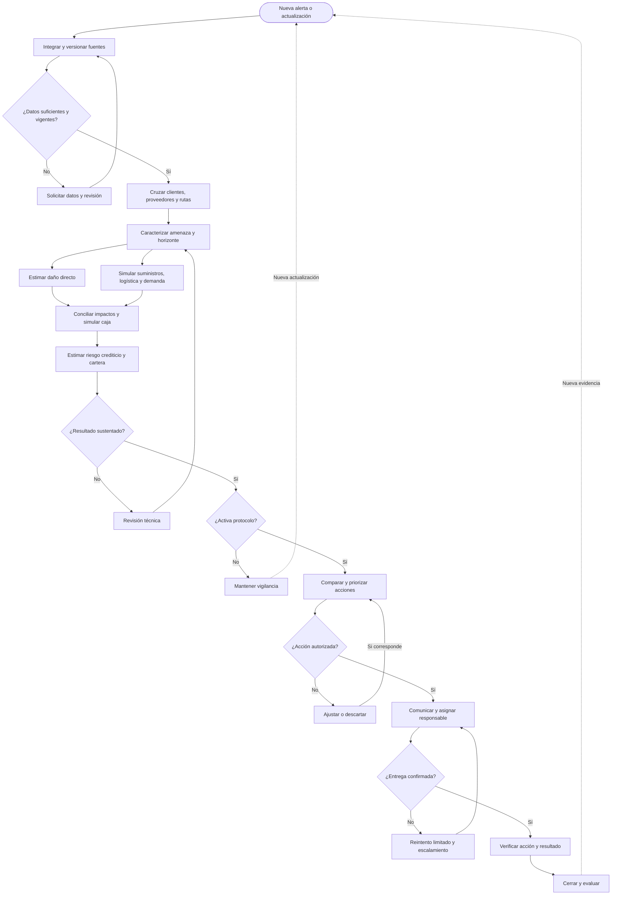

# CajaEscudo · Plan de evolución RIE-01

Fecha: **2026-11-26**. Estado: **propuesta registrada; implementación pendiente**.

### Actualización de ejecución: simulación CE-2.0

Se implementó una primera aproximación **local y sintética**, descrita en
[simulacion-red-ce2.md](simulacion-red-ce2.md): cadenas interregionales simplificadas,
inventario, sustitución, propagación a caja/crédito, comparación de canales y
seguimiento hasta cierre. No es el backend objetivo ni un solver nacional.
Los conectores oficiales, entrenamiento empírico, LangGraph/LLM, autenticación
institucional y despliegue de workers siguen pendientes.
Las tablas siguientes conservan el punto de partida y la hoja de ruta originales.

## 1. Objetivo y diferencial

Anticipar cómo una amenaza climática puede afectar el negocio, su capacidad de
pago y la cartera de Caja Trujillo, y proponer acciones preventivas supervisadas.

El diferencial es el **riesgo climático en red**: un cliente fuera del área del
desastre puede sufrir desabastecimiento, sobrecostos, retrasos o pérdida de demanda
porque sus proveedores, compradores o rutas están afectados en otras regiones.
El alcance nacional es una dirección de crecimiento, no cobertura ya demostrada.

Separar siempre:

- Cartera expuesta, daño económico y pérdida crediticia.
- Impacto directo, indirecto y combinado, sin doble conteo.
- Observación, pronóstico, escenario supuesto y resultado simulado.
- Relaciones confirmadas, declaradas e inferidas.
- Probabilidad de falta de caja, atraso e incumplimiento.

La exposición climática no implica incumplimiento. Una interrupción puede
beneficiar a proveedores alternativos; no propagar pérdidas a todos por defecto.

## 2. Punto de partida real

Consultar [la documentación de la demo](cajaescudo-rie01.md).

| Capacidad | Estado al registrar este plan |
|---|---|
| Cartera de 60 clientes y amenazas | Sintéticas |
| Beta–Bernoulli, Monte Carlo y mochila 0/1 | Implementados localmente |
| Función logística de estrés | Implementada con coeficientes supuestos, no entrenada |
| Agentes | Deterministas locales, sin LLM conectado |
| Revisión | Guardada en navegador; no autorización institucional |
| API FastAPI/PostgreSQL | Existente en `apps/api`, no conectada a la demo |
| Fuentes oficiales en vivo y red de suministros | Pendientes |
| PD/LGD calibradas y efectos causales de acciones | No disponibles |

No reemplazar la demo ni presentar el plan como producto terminado.

## 3. Antecedentes que orientan el diseño

| Antecedente | Qué adoptar | Qué no afirmar |
|---|---|---|
| Atram/Bancamía, Colombia | Alertas, preparación y atención conectadas | Reducción de mora ya demostrada por ese piloto |
| Advans Ghana | Cruce de sectores, territorio y cartera; atención a comercio urbano | Que agricultura concentra siempre el riesgo |
| BRAC, Bangladesh | Protocolos financieros preparados antes del shock | Que todo afectado necesita más deuda |
| Acción anticipatoria OCHA | Pronóstico + umbrales + responsables + recursos | Que resultados humanitarios prueban efectos crediticios en Perú |
| CLIMADA/JRC | Amenaza, exposición, vulnerabilidad e incertidumbre | Que curvas globales están calibradas para microempresas peruanas |

Referencias:

- [CGAP, Built to Adapt](https://www.cgap.org/research/publication/built-to-adapt-inclusive-financial-institutions-in-changing-climate).
- [Lane, crédito y adaptación, Econometrica 2024](https://onlinelibrary.wiley.com/doi/full/10.3982/ECTA19127).
- [OCHA, marco Bangladesh 2025](https://www.unocha.org/publications/report/bangladesh/anticipatory-action-framework-bangladesh-monsoon-floods-2025-version).
- [CLIMADA](https://climada.ethz.ch/features).
- [JRC, estrés sobre préstamos a pymes, 2025](https://publications.jrc.ec.europa.eu/repository/bitstream/JRC142464/JRC142464_01.pdf).

## 4. Proceso de automatización objetivo

El diagrama es una especificación de proceso, no infraestructura desplegada.
Versión editable de la conversación:
[FigJam](https://www.figma.com/board/V6lw88jlOtlMogPraJvrP5).

Controles transversales: privacidad, permisos, evidencia, versiones, semillas,
umbrales aprobados, trazas y tratamiento explícito de información insuficiente.
Una falla de datos no debe suprimir la visualización de un aviso oficial vigente:
mostrarlo, indicando que la estimación financiera no está disponible.

## 5. Modelos y herramientas propuestos

### Amenaza

- Consumir pronósticos existentes y contrastarlos con observaciones SENAMHI.
- Estimar superación de umbrales: `p = miembros que superan / total de miembros`.
- Evaluar calibración local; esa fracción no es probabilidad calibrada por defecto.
- No tratar lluvia, caudal, profundidad y susceptibilidad como intercambiables.
- Beta–Bernoulli queda como demostración de frecuencia o baseline apropiado,
  no como reemplazo de un pronóstico condicionado al estado meteorológico.

### Daño directo

`D(i,e) = suma_k V(i,k) × f(sector,k,intensidad(i,e))`

Usar funciones JRC/CLIMADA como referencia y documentar adaptación local.
La profundidad-daño requiere profundidad: sin mapa o modelo apropiado, utilizar
escenarios explícitos, no inventar centímetros de agua por cliente.
No usar saldo crediticio como valor de activos.

### Red de suministros

- Grafo comercial: proveedores, negocios, productos, compradores y mercados.
- Grafo logístico: vías, nodos de distribución, tiempos y capacidad.
- Conexiones con porcentaje de compras/ventas, plazo, inventario, alternativas
  y evidencia. Un camino calculado no prueba una ruta utilizada.
- Simulación diaria de inventario:
  `I(k,t+1) = I(k,t) + entregas(k,t) − consumo(k,t)`.
- Limitar producción por insumos críticos complementarios; modelar comercio
  como disponibilidad y ventas de mercadería.
- Introducir sustitución limitada, capacidades, retrasos y recuperación.
- Dijkstra/A*, flujo de costo mínimo y simulación de eventos discretos.
- NetworkX + SimPy; OR-Tools para asignaciones con restricciones.
- Centralidad identifica nodos críticos, no pérdidas en soles.

Para relaciones sectoriales agregadas, evaluar matrices insumo-producto.
El Leontief convencional es principalmente una estructura de demanda; no aplicar
su inversa mecánicamente a shocks de oferta. Modelos de oferta requieren
restricciones, inventarios, racionamiento y validación específicos.
Las matrices nacionales no identifican flujos interregionales ni proveedores
individuales. La referencia INEI 2007 exige cautela y actualización justificada.

### Precios, ventas y caja

- Baseline estacional antes de SARIMAX/regresión dinámica con exógenas.
- Solo entrenar con series suficientes y disponibles al momento de predicción.
- Si faltan elasticidades o series, usar escenarios de precios declarados.
- `Caja(t+1) = Caja(t) + ingresos(t) − egresos(t) − servicio_deuda(t)`.
- Incorporar inventario, sobrecostos, gastos del hogar cuando corresponda,
  liquidez inicial, otras deudas, estacionalidad y recuperación.
- Medir pérdida de margen, no sumar toda venta perdida como pérdida neta.
- Conciliar daño, reposición, ventas e inventario para evitar doble conteo.

### Crédito y cartera

- Modelo candidato: supervivencia mensual en tiempo discreto con logística/GAM.
- `PD(T) = 1 − producto_t(1 − h(t))`.
- Comparar con CatBoost cuando existan datos y etiquetas suficientes.
- Definir eventos, censura y horizonte; no confundir atraso 30 días con default.
- Estimar LGD con recuperaciones observadas; sin ellas, escenarios explícitos.
- `EL = PD × LGD × EAD` como aproximación de horizonte consistente.
- Monte Carlo con shocks compartidos por evento, región y cadena; calcular
  dentro de cada trayectoria y agregar después, preservando dependencias.
- Distinguir distribuciones de EL condicional de pérdidas realizadas.
- No etiquetar como provisión, capital o VaR regulatorio sin metodología aprobada.

### Intervenciones

Maximizar reducción esperada bajo presupuesto, capacidad, tiempos y restricciones
de inclusión. Comparar con/sin intervención usando shocks emparejados.
Los beneficios son contrafactuales bajo supuestos, no eficacia causal demostrada.
Evaluar alternativas no crediticias y no recomendar deuda automáticamente.

## 6. Arquitectura propuesta

Reutilizar `apps/web` y `apps/api`; no rehacer el frontend como requisito.

| Capa | Selección propuesta | Cuándo |
|---|---|---|
| Servicio | FastAPI + Pydantic; conservar SQLModel/Psycopg existentes | Conectar backend |
| Persistencia | PostgreSQL y PostGIS, previa comprobación de extensión y acceso | Geografía y trazas |
| Originales | Archivos versionados; S3 compatible cuando sea necesario | Desde primera ingesta |
| Ingesta | HTTPX, Pandas, Prefect para jobs persistentes | Primer conector, luego orquestación |
| Geografía | GeoPandas, Shapely, Rasterio, xarray; cfgrib/cdsapi según formato | Según fuente |
| Suministros | NetworkX + SimPy | MVP diferencial |
| Estadística | NumPy, SciPy, statsmodels, scikit-learn | Motor y validación |
| Opcionales | CLIMADA, CatBoost, PyMC, OR-Tools, MLflow | Según datos y complejidad |
| Agentes | LangGraph con persistencia y adaptador de proveedor | Después del motor |
| Calidad | pytest y pruebas existentes del frontend | Cada entrega |

Los trabajos largos y modelos locales necesitan un worker/servidor apropiado;
no asumir que caben en funciones serverless o en el hosting del frontend.
Evaluar límites y costo antes de desplegar. No crear servicios de pago por defecto.

## 7. Agentes y límites

| Rol | Responsabilidad | Límite |
|---|---|---|
| Evidencia | Recuperar documentos, extraer campos y señalar faltantes | Dominios/herramientas permitidos |
| Dependencias | Proponer y consultar relaciones económicas | Inferencias pendientes de confirmación |
| Análisis | Ejecutar funciones y explicar salidas | No modificar valores calculados |
| Respuesta | Preparar recomendaciones y tareas | Aprobación humana para acciones sensibles |

No todo nodo necesita LLM: ingesta, fechas, geometrías, cálculos y permisos
son código determinista. Persistir resultados de herramientas, no razonamiento
interno del modelo. Limitar pasos, reintentos, tokens y costos.
Consultar [la decisión LLM propuesta](alternativas-llm-costos.md).

## 8. Interfaz objetivo

| Vista | Contenido y acción principal |
|---|---|
| Vigilancia | Mapa, eventos, vigencia, exposición directa/indirecta y cola priorizada |
| Evento | Impacto por región/sector, clientes, calidad y escenarios |
| Expediente | Daño, caja, crédito, dependencias, fuentes y explicación |
| Simulador | Sin/con intervención, rangos, costos y supuestos |
| Acciones | Aprobación, responsable, contacto, entrega, seguimiento y cierre |

Integrar estas capacidades en la navegación existente cuando sea posible.
Añadir vista de cadena: evento → proveedor/ruta → insumo → negocio → caja.
Mostrar inventario, concentración, sustitución y procedencia de cada relación.
Etiquetar datos sintéticos/inferidos y advertir incertidumbre dentro del flujo.
Un panel de trazas complementa la interfaz; un chatbot no sustituye al producto.

## 9. Entregables y secuencia

Todo lo siguiente permanece pendiente. No hay fechas ni presupuesto aprobados.

| ID | Entrega | Dependencia | Criterio de aceptación |
|---|---|---|---|
| P0 | Contratos y catálogo de datos | Acordar cadena piloto | Separar confirmado/inferido/sintético; fuentes, unidades y vigencia |
| P1 | Primer conector y replay local | P0; revisar licencia | Consulta reproducible, original guardado, fallo y obsolescencia visibles |
| P2 | Cruce geográfico y rutas | P1; capas adecuadas | Geometrías y CRS validados; escenario conocido verificable |
| P3 | Cadena interregional | P0–P2 | Cliente fuera del desastre afectado por inventario/ruta; sustitución comprobable |
| P4 | Impacto, caja y cartera | P3 | Conciliación directa/indirecta, semillas, incertidumbre y parámetros visibles |
| P5 | Vistas y revisión | P4 | Recorrido de alerta a tarea y seguimiento, sin decisión crediticia automática |
| P6 | Evaluación y conexión LLM opcional | Herramientas estables; evaluación de privacidad | Comparación de candidatos y fallback determinista |
| P7 | Validación empírica/piloto | Datos autorizados y expertos | Pruebas fuera de muestra y aprobación antes de uso real |

Demo propuesta: una cadena agroalimentaria entre regiones, una amenaza de
inundación, un distribuidor, una ruta interrumpida, una alternativa y negocios
distantes. Productos/regiones finales y tamaño se definirán según datos.
No prometer cobertura exhaustiva del Perú en el MVP.

## 10. Validación y seguridad

- Separar entrenamiento/prueba por tiempo, zona y evento.
- Usar pronósticos archivados tal como fueron emitidos para backtesting:
  un reanálisis posterior no reproduce la información disponible entonces.
- Amenaza: Brier/calibración, detección, falsas alarmas y anticipación.
- Daño/caja: MAE, cobertura de intervalos y errores por sector.
- Crédito: PR-AUC, Brier y curvas de calibración; baseline sin clima.
- Red: agotamiento, conservación de unidades, cortes, rutas alternativas,
  proveedores compartidos, sustitución y recuperación.
- Operación: entrega, tiempo de respuesta y ejecución confirmada.
- Inclusión: errores, cobertura y priorización por segmento y zona.
- Datos sintéticos prueban funcionamiento, no precisión crediticia real.
- Autenticación y roles en backend antes de usar datos reales.
- Minimización de datos, cifrado, controles de acceso y retención.
- Validar documentos externos contra inyección de instrucciones.
- No almacenar claves en frontend, git o trazas.
- No reentrenar ni cambiar umbrales automáticamente.

## 11. Decisiones abiertas

- Cadena, regiones y amenaza final del piloto.
- Acceso a históricos de pagos, recuperaciones y proveedores.
- Licencias, disponibilidad y antigüedad de cada capa.
- Proveedor LLM y presupuesto después de evaluación.
- Infraestructura para jobs y, si aplica, inferencia local.
- Políticas y responsables institucionales de revisión y contacto.
